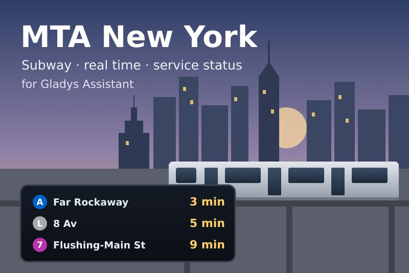
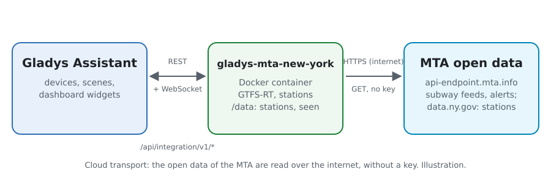
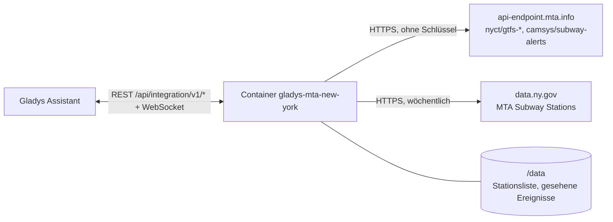
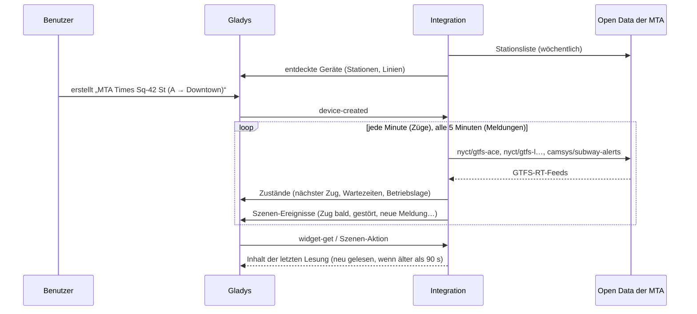
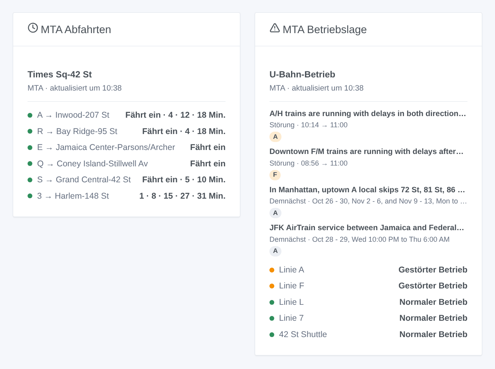

# Gladys MTA New York

[English](README.md) · [Français](README.fr.md) · **Deutsch** · [Español](README.es.md)

[](LICENSE)
[](https://github.com/William-De71/gladys-mta-new-york/releases)
[](https://github.com/William-De71/gladys-mta-new-york/actions/workflows/release.yml)
[](https://gladysassistant.com)



Externe [Gladys Assistant](https://gladysassistant.com)-Integration für die **New Yorker U-Bahn** der MTA und die Staten Island Railway: die nächsten Züge an deinen Stationen in Echtzeit, wie die Countdown-Anzeigen, und die Betriebslage deiner Linien, mit Szenen und Dashboard-Widgets. Sie liest die offiziellen Open Data der MTA (GTFS-RT-Feeds, Betriebsmeldungen, Stationsliste), ohne Konto und ohne Schlüssel.

Benutzerdokumentation: [English](docs/en.md) · [Français](docs/fr.md) · [Deutsch](docs/de.md) · [Español](docs/es.md).

> Community-Integration, weder mit der MTA verbunden noch von ihr unterstützt oder lizenziert. Die Daten stammen von den Servern der MTA und werden so gezeigt, wie sie sind: Sie können ungenau, unvollständig und nicht in Echtzeit sein.

## Funktionen

- **Ein Gerät pro verfolgter Station** (drei im Formular, bis zu 10 weitere über die Schaltfläche **Station hinzufügen**), per Name oder Haltestellen-ID eingegeben und nach **Linie** und **Richtung** gefiltert (Uptown / Downtown oder die Wörter am Bahnsteig): nächster Zug, Wartezeit der nächsten zwei Züge.
- **Ein Gerät pro verfolgter Linie** (bis zu sechs): ihre Betriebslage (normal, Hinweis, geplante Bauarbeiten, gestört, eingestellt) aus den Meldungen der MTA und die aktuellen Meldungen.
- **Stationen als Komplexe**: Times Sq-42 St vereint 1 2 3, 7, N Q R W, S und A C E; gleiche Namen („86 St“) werden durch ihre Linien unterschieden.
- **4 Szenen-Auslöser**, **2 Szenen-Aktionen** und **2 Dashboard-Widgets** (unten).
- **Eine Anfrage pro Liniengruppe**: der A-C-E-Feed einmal für alle Stationen dieser Linien, standardmäßig jede Minute (30 s bis 5 Min., alle 10 Min., wenn nichts angekündigt ist), die Meldungen alle 5 Minuten, die Stationsliste wöchentlich (eine Kopie liegt im Image).
- Konfigurationsschaltflächen: Verbindung testen, Station suchen (Bezirk, Haltestellen-IDs, Linien), Stationen hinzufügen / entfernen / auflisten, Diagnose.
- Überall vier Sprachen: Englisch, Französisch, Deutsch, Spanisch.

## Funktionsweise





Beim Start liest die Integration die Stationsliste (die in `/data` gespeicherte Kopie, sonst die des Images, und einmal pro Woche eine frische von data.ny.gov) und fasst ihre Zeilen zu Komplexen zusammen. Dann löst sie deine Eingaben auf: „times sq“ ist der Komplex Times Sq-42 St, „R16“ die Station dieser Haltestellen-ID, „the A train“ die Linie `A`. Die MTA veröffentlicht einen Echtzeit-Feed pro Liniengruppe: Mit ihrem eigenen Timer liest die Integration die Feeds der Linien deiner Stationen, jeden einmal. Jeder Zug listet seine Halte bis zur Endstation: Ein Zug, der einen Bahnsteig deiner Station anfährt (`A27S`: die Station und ihre Seite), ist eine Abfahrt, sein letzter Halt das Ziel. Alle 5 Minuten liest sie die Meldungen mit ihrer Art („Delays“, „Planned - Part Suspended“…). Jede Lesung wird mit der vorherigen verglichen, um die Szenen auszulösen.



### Transport

Nur Cloud (`"transports": ["cloud"]`): Der Katalog zeigt das Cloud-Abzeichen. Die Integration kontaktiert `api-endpoint.mta.info` und `data.ny.gov`. Es gibt keine lokale Alternative, daher keine Schaltfläche „Lokale Verbindung bevorzugen“.

## Geräte und Funktionen

| Gerät                 | Funktion                 | Kategorie / Typ              | Werte                                         |
| --------------------- | ------------------------ | ---------------------------- | --------------------------------------------- |
| MTA \<Station\>       | Nächster Zug             | `text` / `text`              | „A → Far Rockaway-Mott Av · 3 Min. (geplant)“ |
| MTA \<Station\>       | Wartezeit, des folgenden | `duration` / `integer`       | 0 … 180 Min.                                  |
| MTA Linie A / Shuttle | Betriebslage             | `text` / `text`              | „Gestörter Betrieb: Downtown F/M trains…“     |
| MTA Linie A / Shuttle | Aktuelle Meldungen       | `counter-sensor` / `integer` | 0 … 20                                        |

„(geplant)“: Der Fahrt ist noch kein Zug zugeteilt. Die MTA liefert keine Verspätung und markiert keinen ausgefallenen Zug: Die Integration veröffentlicht beides nicht.

## Szenen-Auslöser, Aktionen und Widgets



**Szenen-Auslöser** (einmal pro Übergang; die erste Lesung ist eine Referenz und löst nichts aus):

- **Zug bald**: Ein Zug an einer verfolgten Station fährt in 2, 3, 5, 10, 15 oder 20 Minuten. Filter: Station, Minuten.
- **Linie gestört**: Eine verfolgte Linie hat ungeplante Verspätungen, Änderungen oder eine Einstellung (geplante Bauarbeiten lösen es nicht aus). Filter: Linie.
- **Wieder normal**: kein ungeplantes Problem mehr auf der Linie. Filter: Linie.
- **Neue Meldung**: Die MTA veröffentlicht eine Meldung zu einer verfolgten Linie, aktuell oder demnächst. Filter: Linie, Art (Hinweis, geplante Bauarbeiten, Verspätungen und Änderungen, Einstellung).

**Szenen-Aktionen**: **nächste Züge** einer Station (Linie, Ziel, Wartezeit, Uhrzeit, geplant oder nicht, der folgende, ein Satz) und **Lage einer Linie** (Zustand, Meldungen, letzte Meldung, ein Satz).

**Widgets**: **MTA Abfahrten** (eine verfolgte Station, mehrere in einer Liste oder eine beliebige in den Einstellungen eingegebene Station) und **MTA Betriebslage** (die verfolgten Linien, die eingegebenen oder standardmäßig die Linien deiner Stationen).

Beispiele:

- Wenn **die L Richtung 8 Av in 5 Minuten in Bedford Av abfährt** → die Flurlampe grün schalten.
- Wenn **die Linie A gestört ist** → `{{triggerEvent.data.summary}}` aufs Handy schicken.
- Jeden Werktag um 7:30 → **die nächsten Züge** deiner Station lesen und die `summary` vom Küchenlautsprecher ansagen lassen.

## Voraussetzungen

- Gladys Assistant **5.3.0** oder neuer (Widgets und Szenen-Auslöser externer Integrationen, Katalog-Schlüsselwörter und Länder von Gladys 5.3). Ältere Instanzen können die Integration nicht installieren.
- Sonst nichts: Die Open Data der MTA brauchen weder Konto noch Schlüssel.

## Installation

- **Aus dem Store** von Gladys (Integrationen → Externe Integrationen), mit einem Klick, sobald indexiert.
- **Über die URL des Repositorys**: `https://github.com/William-De71/gladys-mta-new-york`.
- **Entwicklermodus**: das Image lokal bauen (`docker build -t gladys-mta-new-york .`) und aus Gladys installieren.

## Konfiguration

| Feld               | Beschreibung                                                                                              |
| ------------------ | --------------------------------------------------------------------------------------------------------- |
| Station (1 bis 3)  | Ein Name, wie er in der Station steht („Times Sq-42 St“, „86 St (Q)“), oder eine Haltestellen-ID („R16“). |
| Linie              | „A“, „7“, „7X“, „S 42 St“, „SIR“. Leer: alle Linien der Station.                                          |
| Richtung           | „Uptown“, „Downtown“, die Wörter am Bahnsteig („Manhattan“) oder des Ziels. Leer: beide.                  |
| Verfolgte Linien   | Bis zu sechs, durch Kommas getrennt: „A, F, L, 7“.                                                        |
| Lesen der Echtzeit | 30 s, 1 Min. (Standard), 2 Min. oder 5 Min.                                                               |
| Sprache der Texte  | Gerätenamen, Szenen-Zusammenfassungen und -Ausgaben.                                                      |

Schaltflächen: **Verbindung testen**, **Station suchen** (Bezirk, Haltestellen-IDs und Linien jeder gefundenen Station), **Station hinzufügen**, **Station entfernen**, **Stationen auflisten** (die Stationen über die drei des Formulars hinaus, in der Gladys-Konfiguration gespeichert) und **Diagnose** (schreibt Stationen, Linien, gelesene Feeds, letzte Abfahrten, Fehler und Anfragen in den Tab Protokolle).

## Verwendung

1. Trage eine bis drei Stationen ein — weitere mit **Station hinzufügen** — (bei Bedarf mit Linie und Richtung) und die zu verfolgenden Linien, dann speichern.
2. Erstelle im Tab **Entdecken** die Geräte „MTA …“.
3. Füge die Widgets **MTA Abfahrten** und **MTA Betriebslage** zu einem Dashboard hinzu und baue Szenen mit den Auslösern oben.

## Entwicklung

```bash
npm install
npm test                       # node --test, nie mit Netzwerkzugriff
npm run lint && npm run format:check
npx github:GladysAssistant/integration-store . --skip-image-check
scripts/build-cover.sh         # cover.jpg aus docs/assets/cover.svg
docs/illustrations/render.sh   # docs/assets/widgets.<lang>.png
node .github/scripts/release.mjs next
```

Lokal liest das SDK `GLADYS_HOST_API_URL`, `GLADYS_INTEGRATION_TOKEN` und `GLADYS_INTEGRATION_SELECTOR`; `MTA_FEEDS_URL` und `MTA_STATIONS_URL` lenken die Integration auf andere Quellen (ein Mock); `DEBUG=gladys-integration-sdk` zeigt die SDK-Logs und prüft jeden Widget-Inhalt. Die Tests nutzen echte, gekürzte Feeds der MTA (`test/fixtures/`) und von `test/helpers/fixtures.js` kodierte Feeds. Die Regeln des Projekts stehen in [CLAUDE.md](CLAUDE.md).

## Release-Prozess


Jeder Merge auf `main` startet die CI und berechnet dann die Version aus den [Conventional Commits](https://www.conventionalcommits.org/de/) seit dem letzten Tag: `feat` → Minor, `fix` / `perf` → Patch, `!` oder `BREAKING CHANGE` → Major (ein Minor unter 1.0.0); `docs`, `chore`, `ci`, `test`, `style`, `refactor`, `build` allein veröffentlichen nichts. Der Changelog-Abschnitt wird erzeugt, der Tag gepusht, das Multi-Architektur-Image gebaut, dann erhält `main` den Release-Commit, das GitHub Release wird erstellt und ein letzter Job prüft das öffentliche Image, den Store-Validator und das Topic.

- Der Titel des Pull Requests wird zum Squash-Commit und dann zur Changelog-Zeile: auf Englisch, für den Nutzer schreiben (`pr-title.yml` prüft ihn). `CHANGELOG.md` nie von Hand bearbeiten.
- 1.0.0 ist eine Entscheidung: Actions → Release → Run workflow mit `release-as: 1.0.0`. `dry-run` zeigt Version und Notizen, ohne zu veröffentlichen.
- **Geschützter Branch**: Das Release pusht seinen Commit mit `GITHUB_TOKEN` auf `main`. Mit einem Ruleset auf `main`, das strenger ist als „kein Löschen, kein Force-Push“, GitHub Actions zur Bypass-Liste hinzufügen (oder über eine GitHub App pushen), sonst schlägt der Veröffentlichungs-Job mit einer Erklärung fehl.
- Nach dem ersten Release das Paket `ghcr.io` öffentlich machen (Package settings → Change visibility), sonst kann Gladys es nicht laden.

## Fehlerbehebung

Siehe [docs/de.md](docs/de.md#fehlerbehebung). Melde Probleme mit den Versionen von Gladys und der Integration, der betroffenen Station oder Linie und den Zeilen der Schaltfläche **Diagnose**.

## Mitwirken

Issues und Pull Requests sind willkommen. Führe vor einem Pull Request `npm run format:check && npm run lint && npm test` aus und lasse alle externen IDs und gespeicherten Schlüssel unverändert (siehe [CLAUDE.md](CLAUDE.md)).

## Sicherheit

Siehe [SECURITY.md](SECURITY.md): Schwachstellen bitte vertraulich melden. Die Integration braucht kein Geheimnis: Sie liest nur öffentliche Open Data und läuft schreibgeschützt, ohne Root, in ihrem Container.

## Kommende Screenshots

Die Bilder oben sind Illustrationen, keine Screenshots. Echte Screenshots kommen in `docs/assets/screenshots/` (PNG, 1280 × 800): `configuration.png`, `discovery.png`, `device.png`, `scene.png`.

## Lizenz

[Apache License 2.0](LICENSE) — siehe auch [NOTICE](NOTICE). Die Echtzeit-Feeds und die Meldungen stammen von den Servern der MTA gemäß ihren [Nutzungsbedingungen für Daten-Feeds](https://www.mta.info/developers/terms-and-conditions); die Stationsliste stammt von [data.ny.gov](https://data.ny.gov/d/39hk-dx4f). Die Widgets zeigen die Quelle und die Zeit jeder Lesung. Danke an die Dokumentation und das SDK von Gladys und an die MTA für die Veröffentlichung dieser Daten in Echtzeit.
