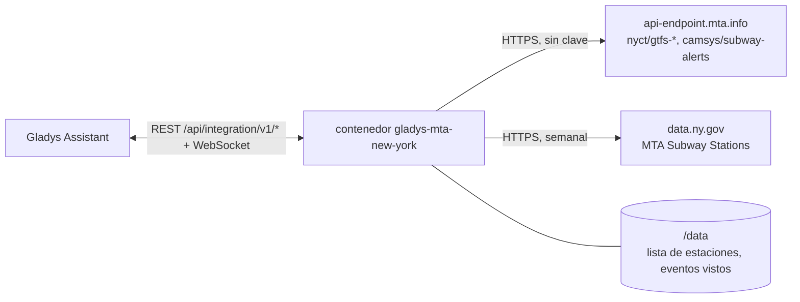
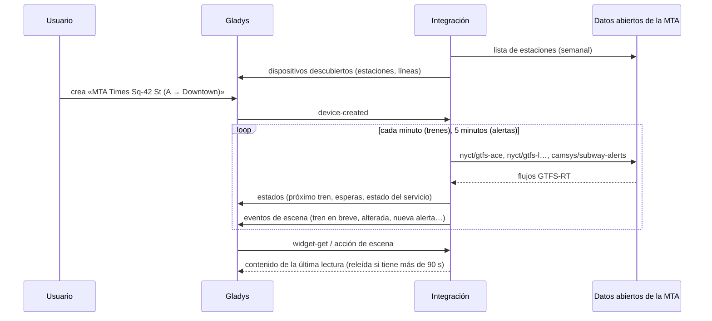
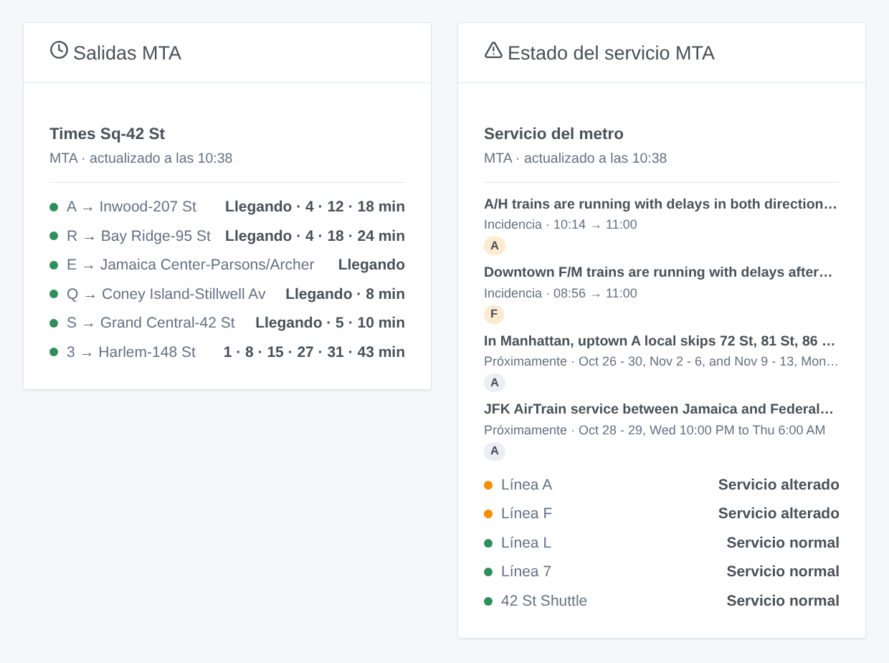

# Gladys MTA New York

[English](README.md) · [Français](README.fr.md) · [Deutsch](README.de.md) · **Español**

[](LICENSE)
[](https://github.com/William-De71/gladys-mta-new-york/releases)
[](https://github.com/William-De71/gladys-mta-new-york/actions/workflows/release.yml)
[](https://gladysassistant.com)


Integración externa de [Gladys Assistant](https://gladysassistant.com) para el **metro de Nueva York** de la MTA y el Staten Island Railway: los próximos trenes en tus estaciones, en tiempo real, como los relojes de cuenta atrás, y el estado del servicio de tus líneas, con escenas y widgets de panel. Lee los datos abiertos oficiales de la MTA (flujos GTFS-RT, alertas de servicio, lista de estaciones), sin cuenta ni clave.

Documentación de usuario: [English](docs/en.md) · [Français](docs/fr.md) · [Deutsch](docs/de.md) · [Español](docs/es.md).

> Integración comunitaria, no afiliada a la MTA ni respaldada ni autorizada por ella. Los datos se obtienen de los servidores de la MTA y se muestran tal cual: pueden ser inexactos, incompletos y no estar en tiempo real.

## Funciones

- **Un dispositivo por estación seguida** (tres en el formulario, hasta 10 más con el botón **Añadir una estación**), escrita por nombre o código de parada, y filtrada por **línea** y **dirección** (Uptown / Downtown, o las palabras del andén): próximo tren, espera de los dos próximos trenes.
- **Un dispositivo por línea seguida** (hasta seis): su estado del servicio (normal, aviso, obras programadas, alterado, suspendido) según las alertas de la MTA, y las alertas en curso.
- **Estaciones por complejo**: Times Sq-42 St reúne 1 2 3, 7, N Q R W, S y A C E; los nombres compartidos («86 St») se distinguen por sus líneas.
- **4 disparadores de escena**, **2 acciones de escena** y **2 widgets de panel** (abajo).
- **Una petición por grupo de líneas**: el flujo A C E una vez para todas las estaciones de esas líneas, cada minuto por defecto (30 s a 5 min, cada 10 min cuando no se anuncia nada), las alertas cada 5 minutos, la lista de estaciones cada semana (una copia viene en la imagen).
- Botones de configuración: probar la conexión, buscar una estación (distrito, códigos de parada, líneas), añadir / quitar / listar estaciones, diagnóstico.
- Cuatro idiomas en todas partes: inglés, francés, alemán, español.

## Cómo funciona




Al arrancar, la integración lee la lista de estaciones (la copia guardada en `/data`, si no la de la imagen, y una nueva de data.ny.gov una vez por semana) y agrupa sus filas en complejos. Después resuelve lo que escribiste: «times sq» es el complejo de Times Sq-42 St, «R16» la estación de ese código de parada, «the A train» la línea `A`. La MTA publica un flujo en tiempo real por grupo de líneas: con su propio temporizador, la integración lee los flujos de las líneas de tus estaciones, cada uno una vez. Cada tren lista sus paradas hasta la terminal: un tren que para en un andén de tu estación (`A27S`: la estación y su lado) es una salida, su última parada el destino. Cada 5 minutos lee las alertas, con su tipo («Delays», «Planned - Part Suspended»…). Cada lectura se compara con la anterior para activar las escenas.



### Transporte

Solo en la nube (`"transports": ["cloud"]`): el catálogo muestra la insignia de nube. La integración contacta con `api-endpoint.mta.info` y `data.ny.gov`. No hay alternativa local, así que no hay botón «Preferir la conexión local».

## Dispositivos y funciones

| Dispositivo           | Función                      | Categoría / tipo             | Valores                                       |
| --------------------- | ---------------------------- | ---------------------------- | --------------------------------------------- |
| MTA \<estación\>      | Próximo tren                 | `text` / `text`              | «A → Far Rockaway-Mott Av · 3 min (previsto)» |
| MTA \<estación\>      | Espera, espera del siguiente | `duration` / `integer`       | 0 … 180 min                                   |
| MTA Línea A / shuttle | Estado del servicio          | `text` / `text`              | «Servicio alterado: Downtown F/M trains…»     |
| MTA Línea A / shuttle | Alertas en curso             | `counter-sensor` / `integer` | 0 … 20                                        |

«(previsto)»: aún no hay tren asignado al trayecto. La MTA no da retrasos ni marca trenes suprimidos: la integración no publica ninguno de los dos.

## Disparadores, acciones de escena y widgets



**Disparadores de escena** (una vez por transición; la primera lectura es una referencia y no activa nada):

- **Tren en breve**: un tren en una estación seguida sale dentro de 2, 3, 5, 10, 15 o 20 minutos. Filtros: estación, minutos.
- **Línea alterada**: una línea seguida sufre retrasos, cambios o una suspensión imprevistos (las obras programadas no lo activan). Filtro: línea.
- **Fin de la incidencia**: ya no hay problemas imprevistos en la línea. Filtro: línea.
- **Nueva alerta**: la MTA publica una alerta sobre una línea seguida, en curso o próxima. Filtros: línea, tipo (aviso, obras programadas, retrasos y cambios, suspensión).

**Acciones de escena**: **próximos trenes** de una estación (línea, destino, espera, hora, previsto o no, el siguiente, una frase) y **estado de una línea** (estado, alertas, última alerta, una frase).

**Widgets**: **Salidas MTA** (una estación seguida, varias en una lista, o cualquier estación escrita en los ajustes) y **Estado del servicio MTA** (las líneas seguidas, las escritas, o las líneas de tus estaciones por defecto).

Ejemplos:

- Cuando **el L hacia 8 Av sale de Bedford Av dentro de 5 minutos** → encender en verde la lámpara de la entrada.
- Cuando **la línea A está alterada** → enviar `{{triggerEvent.data.summary}}` a tu teléfono.
- Cada día laborable a las 7:30 → **leer los próximos trenes** de tu estación y que el altavoz de la cocina diga el `summary`.

## Requisitos

- Gladys Assistant **5.3.0** o posterior (widgets y disparadores de escena de las integraciones externas, palabras clave y países del catálogo de Gladys 5.3). Las instancias más antiguas no pueden instalar la integración.
- Nada más: los datos abiertos de la MTA no necesitan cuenta ni clave.

## Instalación

- **Desde la tienda** de Gladys (Integraciones → Integraciones externas), en un clic, una vez indexada.
- **Desde la URL del repositorio**: `https://github.com/William-De71/gladys-mta-new-york`.
- **Modo desarrollador**: construye la imagen localmente (`docker build -t gladys-mta-new-york .`) e instálala desde Gladys.

## Configuración

| Campo                   | Descripción                                                                                              |
| ----------------------- | -------------------------------------------------------------------------------------------------------- |
| Estación (1 a 3)        | Un nombre tal como aparece en la estación («Times Sq-42 St», «86 St (Q)») o un código de parada («R16»). |
| Línea                   | «A», «7», «7X», «S 42 St», «SIR». Vacío: todas las líneas de la estación.                                |
| Dirección               | «Uptown», «Downtown», las palabras del andén («Manhattan») o del destino. Vacío: ambos.                  |
| Líneas seguidas         | Hasta seis, separadas por comas: «A, F, L, 7».                                                           |
| Lectura del tiempo real | 30 s, 1 min (por defecto), 2 min o 5 min.                                                                |
| Idioma de los textos    | Nombres de dispositivos, resúmenes y salidas de las escenas.                                             |

Botones: **Probar la conexión**, **Buscar una estación** (distrito, códigos de parada y líneas de cada estación encontrada), **Añadir una estación**, **Quitar una estación**, **Listar las estaciones** (las estaciones además de las tres del formulario, guardadas en la configuración de Gladys) y **Diagnóstico** (escribe estaciones, líneas, flujos leídos, últimas salidas, errores y peticiones en la pestaña Registros).

## Uso

1. Escribe de una a tres estaciones — más con **Añadir una estación** — (con su línea y dirección si quieres) y las líneas a seguir, y guarda.
2. En la pestaña **Descubrir**, crea los dispositivos «MTA …».
3. Añade los widgets **Salidas MTA** y **Estado del servicio MTA** a un panel, y crea escenas con los disparadores de arriba.

## Desarrollo

```bash
npm install
npm test                       # node --test, nunca toca la red
npm run lint && npm run format:check
npx github:GladysAssistant/integration-store . --skip-image-check
scripts/build-cover.sh         # cover.jpg desde docs/assets/cover.svg
docs/illustrations/render.sh   # docs/assets/widgets.<lang>.png
node .github/scripts/release.mjs next
```

En local, el SDK lee `GLADYS_HOST_API_URL`, `GLADYS_INTEGRATION_TOKEN` y `GLADYS_INTEGRATION_SELECTOR`; `MTA_FEEDS_URL` y `MTA_STATIONS_URL` apuntan la integración a otras fuentes (un simulador); `DEBUG=gladys-integration-sdk` muestra los registros del SDK y comprueba cada contenido de widget. Las pruebas usan flujos reales de la MTA, reducidos (`test/fixtures/`), y flujos codificados por `test/helpers/fixtures.js`. Las reglas del proyecto están en [CLAUDE.md](CLAUDE.md).

## Proceso de publicación


Cada fusión en `main` lanza la CI y luego calcula la versión según los [Conventional Commits](https://www.conventionalcommits.org/es/) desde la última etiqueta: `feat` → menor, `fix` / `perf` → parche, `!` o `BREAKING CHANGE` → mayor (una menor por debajo de 1.0.0); `docs`, `chore`, `ci`, `test`, `style`, `refactor`, `build` solos no publican nada. Se genera la sección del changelog, se sube la etiqueta, se construye la imagen multiarquitectura, luego `main` recibe el commit de publicación, se crea la GitHub Release y un último job comprueba la imagen pública, el validador de la tienda y el topic.

- El título de la pull request se convierte en el commit squash y luego en la línea del changelog: escríbelo en inglés, para el usuario (`pr-title.yml` lo comprueba). No edites nunca `CHANGELOG.md` a mano.
- 1.0.0 es una decisión: Actions → Release → Run workflow con `release-as: 1.0.0`. `dry-run` muestra la versión y las notas sin publicar nada.
- **Rama protegida**: la publicación sube su commit a `main` con `GITHUB_TOKEN`. Con un ruleset en `main` más estricto que «sin borrado ni force-push», añade GitHub Actions a su lista de excepciones (o sube mediante una GitHub App); si no, el job de publicación falla explicándolo.
- Tras la primera publicación, haz público el paquete `ghcr.io` (Package settings → Change visibility), si no Gladys no puede descargarlo.

## Solución de problemas

Ver [docs/es.md](docs/es.md#solución-de-problemas). Informa de los problemas con las versiones de Gladys y de la integración, la estación o línea afectada y las líneas del botón **Diagnóstico**.

## Contribuir

Issues y pull requests bienvenidos. Ejecuta `npm run format:check && npm run lint && npm test` antes de abrir una pull request, y mantén sin cambios todos los identificadores externos y claves guardadas (ver [CLAUDE.md](CLAUDE.md)).

## Seguridad

Ver [SECURITY.md](SECURITY.md): informa de las vulnerabilidades en privado. La integración no necesita ningún secreto: solo lee datos abiertos públicos y funciona en solo lectura, sin root, en su contenedor.

## Capturas pendientes

Las imágenes de arriba son ilustraciones, no capturas de pantalla. Las capturas reales irán en `docs/assets/screenshots/` (PNG, 1280 × 800): `configuration.png`, `discovery.png`, `device.png`, `scene.png`.

## Licencia

[Apache License 2.0](LICENSE) — ver también [NOTICE](NOTICE). Los flujos en tiempo real y las alertas se obtienen de los servidores de la MTA según sus [términos para los flujos de datos](https://www.mta.info/developers/terms-and-conditions); la lista de estaciones procede de [data.ny.gov](https://data.ny.gov/d/39hk-dx4f). Los widgets muestran la fuente y la hora de cada lectura. Gracias a la documentación y al SDK de Gladys, y a la MTA por publicar estos datos en tiempo real.
