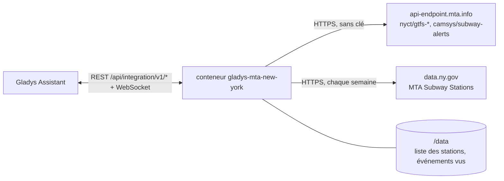
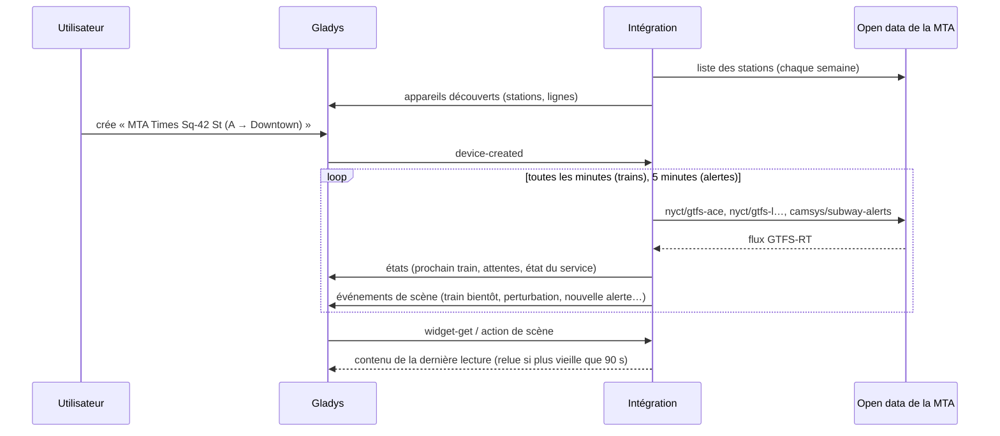
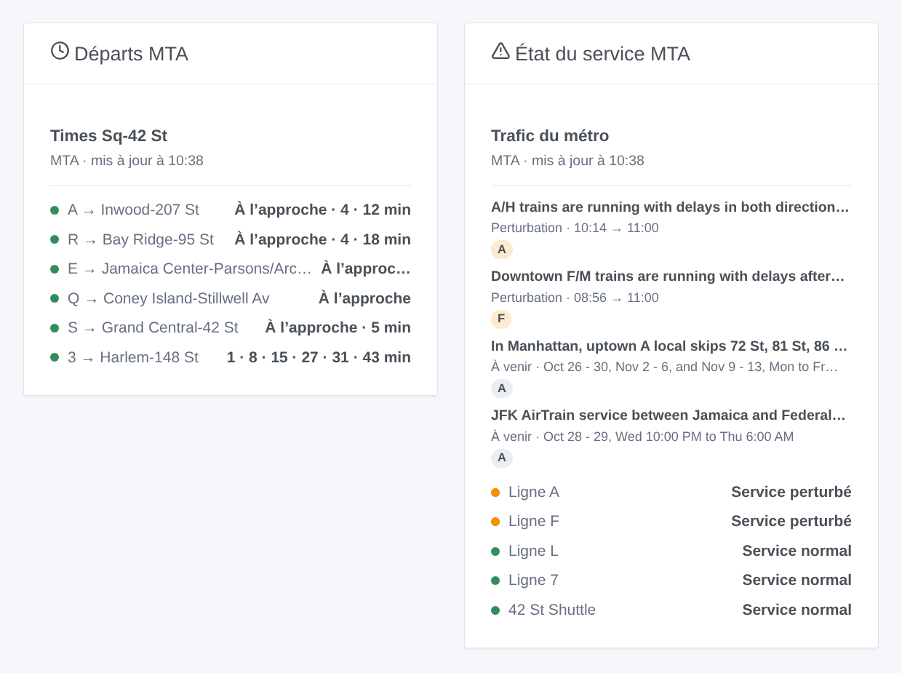

# Gladys MTA New York

[English](README.md) · **Français** · [Deutsch](README.de.md) · [Español](README.es.md)

[](LICENSE)
[](https://github.com/William-De71/gladys-mta-new-york/releases)
[](https://github.com/William-De71/gladys-mta-new-york/actions/workflows/release.yml)
[](https://gladysassistant.com)


Intégration externe [Gladys Assistant](https://gladysassistant.com) pour le **métro de New York** de la MTA et le Staten Island Railway : les prochains trains à vos stations, en temps réel, comme les afficheurs des quais, et l’état du service de vos lignes, avec scènes et widgets de tableau de bord. Elle lit l’open data officiel de la MTA (flux GTFS-RT, alertes de service, liste des stations), sans compte ni clé.

Documentation utilisateur : [English](docs/en.md) · [Français](docs/fr.md) · [Deutsch](docs/de.md) · [Español](docs/es.md).

> Intégration communautaire, ni affiliée à la MTA, ni approuvée ou agréée par elle. Les données sont obtenues des serveurs de la MTA et montrées telles quelles : elles peuvent être inexactes, incomplètes et pas en temps réel.

## Fonctionnalités

- **Un appareil par station suivie** (trois dans le formulaire, jusqu’à 10 de plus avec le bouton **Ajouter une station**), saisie par nom ou code d’arrêt, et filtrée par **ligne** et **direction** (Uptown / Downtown, ou les mots du quai) : prochain train, attente des deux prochains trains.
- **Un appareil par ligne suivie** (six au plus) : son état du service (normal, information, travaux programmés, perturbé, suspendu) d’après les alertes de la MTA, et les alertes en cours.
- **Stations par complexe** : Times Sq-42 St réunit les 1 2 3, 7, N Q R W, S et A C E ; les noms partagés (« 86 St ») se distinguent par leurs lignes.
- **4 déclencheurs de scène**, **2 actions de scène** et **2 widgets** (ci-dessous).
- **Une requête par groupe de lignes** : le flux A C E une fois pour toutes les stations de ces lignes, toutes les minutes par défaut (30 s à 5 min, toutes les 10 min quand rien n’est annoncé), les alertes toutes les 5 minutes, la liste des stations chaque semaine (une copie est livrée dans l’image).
- Boutons de configuration : tester la connexion, chercher une station (arrondissement, codes d’arrêt, lignes), ajouter / retirer / lister des stations, diagnostic.
- Quatre langues partout : anglais, français, allemand, espagnol.

## Fonctionnement




Au démarrage, l’intégration lit la liste des stations (la copie gardée dans `/data`, sinon celle de l’image, et une copie fraîche de data.ny.gov une fois par semaine) et regroupe ses lignes en complexes. Elle résout ensuite ce que vous avez saisi : « times sq » est le complexe de Times Sq-42 St, « R16 » la station de ce code d’arrêt, « the A train » la ligne `A`. La MTA publie un flux temps réel par groupe de lignes : sur son propre minuteur, l’intégration lit les flux des lignes de vos stations, chacun une fois. Chaque train liste ses arrêts jusqu’au terminus : un train qui dessert un quai de votre station (`A27S` : la station et son côté) est un départ, son dernier arrêt la destination. Toutes les 5 minutes, elle lit les alertes, avec leur type (« Delays », « Planned - Part Suspended »…). Chaque lecture est comparée à la précédente pour déclencher les scènes.



### Transport

Cloud uniquement (`"transports": ["cloud"]`) : le catalogue affiche le badge cloud. L’intégration contacte `api-endpoint.mta.info` et `data.ny.gov`. Il n’y a pas d’alternative locale, donc pas de bouton « Préférer la connexion locale ».

## Appareils et fonctionnalités

| Appareil              | Fonctionnalité              | Catégorie / type             | Valeurs                                      |
| --------------------- | --------------------------- | ---------------------------- | -------------------------------------------- |
| MTA \<station\>       | Prochain train              | `text` / `text`              | « A → Far Rockaway-Mott Av · 3 min (prévu) » |
| MTA \<station\>       | Attente, attente du suivant | `duration` / `integer`       | 0 … 180 min                                  |
| MTA Ligne A / navette | État du service             | `text` / `text`              | « Service perturbé : Downtown F/M trains… »  |
| MTA Ligne A / navette | Alertes en cours            | `counter-sensor` / `integer` | 0 … 20                                       |

« (prévu) » : aucun train n’est encore affecté au trajet. La MTA ne donne aucun retard et ne marque aucun train supprimé : l’intégration ne publie ni l’un ni l’autre.

## Déclencheurs, actions de scène et widgets



**Déclencheurs de scène** (une fois par transition ; la première lecture sert de référence et ne déclenche rien) :

- **Train bientôt** : un train à une station suivie part dans 2, 3, 5, 10, 15 ou 20 minutes. Filtres : station, minutes.
- **Ligne perturbée** : une ligne suivie subit des retards, des changements ou une suspension imprévus (les travaux programmés ne le déclenchent pas). Filtre : ligne.
- **Fin de perturbation** : plus de souci imprévu sur la ligne. Filtre : ligne.
- **Nouvelle alerte** : la MTA publie une alerte sur une ligne suivie, en cours ou à venir. Filtres : ligne, type (information, travaux programmés, retards et changements, suspension).

**Actions de scène** : **prochains trains** d’une station (ligne, destination, attente, heure, prévu ou non, le suivant, une phrase) et **état d’une ligne** (état, alertes, dernière alerte, une phrase).

**Widgets** : **Départs MTA** (une station suivie, plusieurs dans une liste, ou n’importe quelle station saisie dans les réglages) et **État du service MTA** (les lignes suivies, celles saisies, ou les lignes de vos stations par défaut).

Exemples :

- Quand **le L vers 8 Av part de Bedford Av dans 5 minutes** → allumer la lampe de l’entrée en vert.
- Quand **la ligne A est perturbée** → envoyer `{{triggerEvent.data.summary}}` sur votre téléphone.
- Chaque jour de semaine à 7 h 30 → **lire les prochains trains** de votre station et faire dire le `summary` par l’enceinte de la cuisine.

## Prérequis

- Gladys Assistant **5.3.0** ou plus récent (widgets et déclencheurs de scène des intégrations externes, mots-clés et pays du catalogue de Gladys 5.3). Les instances plus anciennes ne peuvent pas installer l’intégration.
- Rien d’autre : l’open data de la MTA ne demande ni compte ni clé.

## Installation

- **Depuis le store** de Gladys (Intégrations → Intégrations externes), en un clic, une fois indexée.
- **Depuis l’URL du dépôt** : `https://github.com/William-De71/gladys-mta-new-york`.
- **Mode développeur** : construisez l’image localement (`docker build -t gladys-mta-new-york .`) et installez-la depuis Gladys.

## Configuration

| Champ                 | Description                                                                                           |
| --------------------- | ----------------------------------------------------------------------------------------------------- |
| Station (1 à 3)       | Un nom tel qu’écrit dans la station (« Times Sq-42 St », « 86 St (Q) ») ou un code d’arrêt (« R16 »). |
| Ligne                 | « A », « 7 », « 7X », « S 42 St », « SIR ». Vide : toutes les lignes de la station.                   |
| Direction             | « Uptown », « Downtown », les mots du quai (« Manhattan ») ou de la destination. Vide : les deux.     |
| Lignes suivies        | Jusqu’à six, séparées par des virgules : « A, F, L, 7 ».                                              |
| Lecture du temps réel | 30 s, 1 min (par défaut), 2 min ou 5 min.                                                             |
| Langue des textes     | Noms des appareils, résumés et sorties des scènes.                                                    |

Boutons : **Tester la connexion**, **Chercher une station** (arrondissement, codes d’arrêt et lignes de chaque station trouvée), **Ajouter une station**, **Retirer une station**, **Lister les stations** (les stations au-delà des trois du formulaire, gardées dans la configuration de Gladys) et **Diagnostic** (écrit les stations, lignes, flux lus, derniers départs, erreurs et requêtes dans l’onglet Journaux).

## Utilisation

1. Saisissez une à trois stations — plus avec **Ajouter une station** — (avec leur ligne et leur direction si vous le souhaitez) et les lignes à suivre, puis enregistrez.
2. Dans l’onglet **Découvrir**, créez les appareils « MTA … ».
3. Ajoutez les widgets **Départs MTA** et **État du service MTA** à un tableau de bord, et construisez des scènes avec les déclencheurs ci-dessus.

## Développement

```bash
npm install
npm test                       # node --test, ne touche jamais au réseau
npm run lint && npm run format:check
npx github:GladysAssistant/integration-store . --skip-image-check
scripts/build-cover.sh         # cover.jpg depuis docs/assets/cover.svg
docs/illustrations/render.sh   # docs/assets/widgets.<lang>.png
node .github/scripts/release.mjs next
```

En local, le SDK lit `GLADYS_HOST_API_URL`, `GLADYS_INTEGRATION_TOKEN` et `GLADYS_INTEGRATION_SELECTOR` ; `MTA_FEEDS_URL` et `MTA_STATIONS_URL` font pointer l’intégration vers d’autres sources (un simulateur) ; `DEBUG=gladys-integration-sdk` affiche les journaux du SDK et vérifie chaque contenu de widget. Les tests utilisent de vrais flux de la MTA, réduits (`test/fixtures/`), et des flux encodés par `test/helpers/fixtures.js`. Les règles du projet sont dans [CLAUDE.md](CLAUDE.md).

## Processus de release


Chaque fusion sur `main` lance la CI, puis calcule la version d’après les [Conventional Commits](https://www.conventionalcommits.org/fr/) depuis le dernier tag : `feat` → mineure, `fix` / `perf` → correctif, `!` ou `BREAKING CHANGE` → majeure (une mineure tant qu’on est sous 1.0.0) ; `docs`, `chore`, `ci`, `test`, `style`, `refactor`, `build` seuls ne publient rien. La section du changelog est générée, le tag poussé, l’image multi-architecture construite, puis `main` reçoit le commit de release, la GitHub Release est créée et un dernier job vérifie l’image publique, le validateur du store et le topic.

- Le titre de la pull request devient le commit squash, puis la ligne du changelog : écrivez-le en anglais, pour l’utilisateur (`pr-title.yml` le vérifie). Ne modifiez jamais `CHANGELOG.md` à la main.
- 1.0.0 est une décision : Actions → Release → Run workflow avec `release-as: 1.0.0`. `dry-run` montre la version et les notes sans rien publier.
- **Branche protégée** : la release pousse son commit sur `main` avec `GITHUB_TOKEN`. Avec un ruleset sur `main` plus strict que « ni suppression ni force-push », ajoutez GitHub Actions à sa liste de contournement (ou poussez via une GitHub App), sinon le job de publication échoue en l’expliquant.
- Après la première release, rendez public le paquet `ghcr.io` (Package settings → Change visibility), sinon Gladys ne peut pas le télécharger.

## Dépannage

Voir [docs/fr.md](docs/fr.md#dépannage). Signalez les problèmes avec les versions de Gladys et de l’intégration, la station ou la ligne concernée, et les lignes du bouton **Diagnostic**.

## Contribuer

Issues et pull requests bienvenues. Lancez `npm run format:check && npm run lint && npm test` avant d’ouvrir une pull request, et gardez inchangés tous les identifiants externes et clés enregistrées (voir [CLAUDE.md](CLAUDE.md)).

## Sécurité

Voir [SECURITY.md](SECURITY.md) : signalez les vulnérabilités en privé. L’intégration n’a besoin d’aucun secret : elle ne lit que des données ouvertes publiques, et tourne en lecture seule, sans root, dans son conteneur.

## Captures à venir

Les images ci-dessus sont des illustrations, pas des captures d’écran. Les vraies captures iront dans `docs/assets/screenshots/` (PNG, 1280 × 800) : `configuration.png`, `discovery.png`, `device.png`, `scene.png`.

## Licence

[Apache License 2.0](LICENSE) — voir aussi [NOTICE](NOTICE). Les flux temps réel et les alertes sont obtenus des serveurs de la MTA selon ses [conditions d’utilisation des flux](https://www.mta.info/developers/terms-and-conditions) ; la liste des stations vient de [data.ny.gov](https://data.ny.gov/d/39hk-dx4f). Les widgets affichent la source et l’heure de chaque lecture. Merci à la documentation et au SDK de Gladys, et à la MTA de publier ces données en temps réel.
