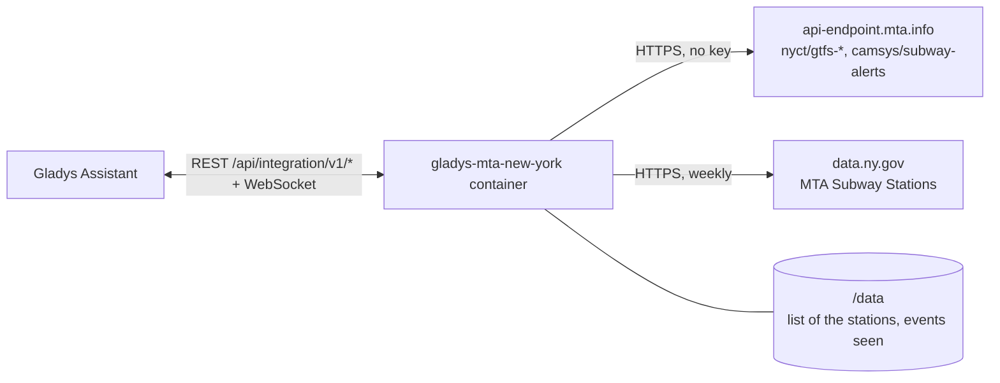
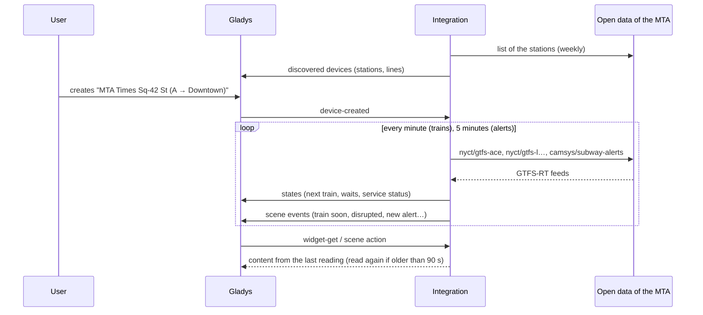
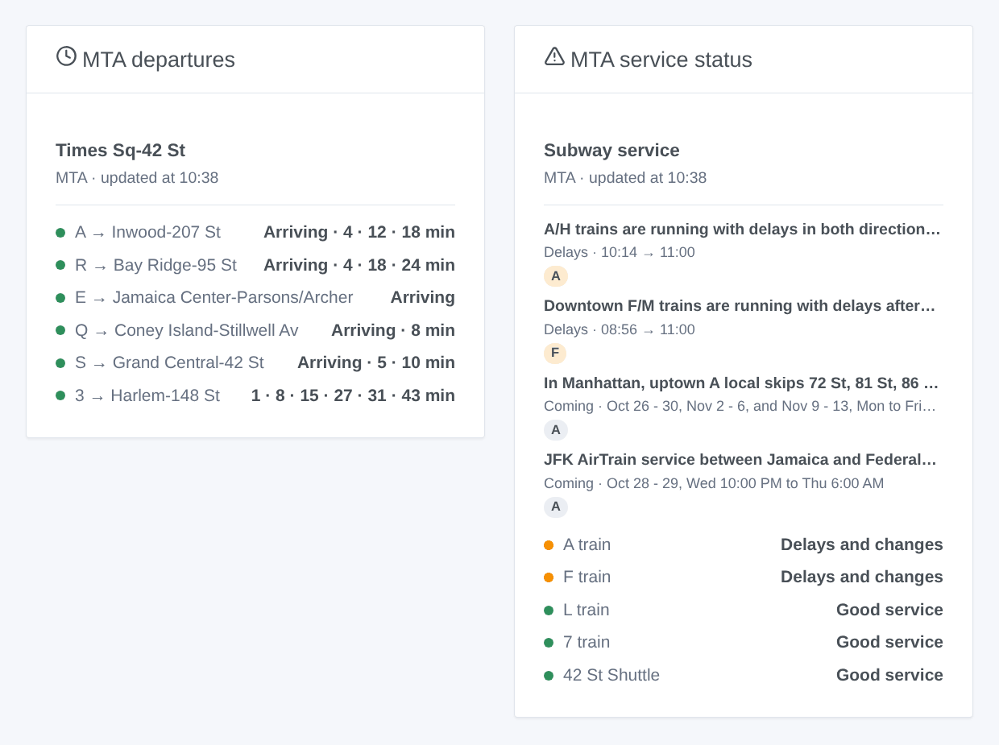

# Gladys MTA New York

**English** · [Français](README.fr.md) · [Deutsch](README.de.md) · [Español](README.es.md)

[](LICENSE)
[](https://github.com/William-De71/gladys-mta-new-york/releases)
[](https://github.com/William-De71/gladys-mta-new-york/actions/workflows/release.yml)
[](https://gladysassistant.com)


[Gladys Assistant](https://gladysassistant.com) external integration for the **New York City subway** of the MTA and the Staten Island Railway: the next trains at your stations, in real time, like the countdown clocks, and the service status of your lines, with scenes and dashboard widgets. It reads the official open data of the MTA (GTFS-RT feeds, service alerts, list of the stations), without an account or a key.

User documentation: [English](docs/en.md) · [Français](docs/fr.md) · [Deutsch](docs/de.md) · [Español](docs/es.md).

> Community integration, not affiliated with, endorsed or licensed by the MTA. The data are obtained from the servers of the MTA and shown as they are: they may be inaccurate, incomplete, and not real time.

## Features

- **One device per followed station** (three in the form, up to 10 more with the **Add a station** button), typed by name or stop id, and filtered by **line** and **direction** (Uptown / Downtown, or the words of the platform): next train, wait of the next two trains.
- **One device per followed line** (up to six): its service status (good service, notice, planned work, delays and changes, suspended) from the alerts of the MTA, and the alerts under way.
- **Stations as complexes**: Times Sq-42 St gathers the 1 2 3, 7, N Q R W, S and A C E; shared names ("86 St") are told apart by their lines.
- **4 scene triggers**, **2 scene actions** and **2 dashboard widgets** (below).
- **One request per group of lines**: the A C E feed once for every station of these lines, every minute by default (30 s to 5 min, every 10 min when nothing is announced), the alerts every 5 minutes, the list of the stations weekly (a copy ships in the image).
- Configuration buttons: test the connection, find a station (borough, stop ids, lines), add / remove / list stations, diagnostic.
- Four languages everywhere: English, French, German, Spanish.

## How it works




At start, the integration reads the list of the stations (the copy kept in `/data`, else the one of the image, and a fresh one from data.ny.gov once a week) and gathers its rows into complexes. It then resolves what you typed: "times sq" is the complex of Times Sq-42 St, "R16" the station of that stop id, "the A train" the route `A`. The MTA publishes one real-time feed per group of lines: on its own timer the integration reads the feeds of the lines of your stations, each once. Every train lists its stops to the terminus: a train calling at a platform of your station (`A27S`: the station and its side) is a departure, its last stop the destination. Every 5 minutes it reads the alerts, with their type ("Delays", "Planned - Part Suspended"…). Each reading is compared with the previous one to fire the scene triggers.



### Transport

Cloud only (`"transports": ["cloud"]`): the catalog shows the cloud badge. The integration contacts `api-endpoint.mta.info` and `data.ny.gov`. There is no local alternative, so there is no "prefer the local connection" button.

## Devices and features

| Device                | Feature                      | Category / type              | Values                                         |
| --------------------- | ---------------------------- | ---------------------------- | ---------------------------------------------- |
| MTA \<station\>       | Next train                   | `text` / `text`              | "A → Far Rockaway-Mott Av · 3 min (scheduled)" |
| MTA \<station\>       | Wait, wait for the following | `duration` / `integer`       | 0 … 180 min                                    |
| MTA A train / shuttle | Service status               | `text` / `text`              | "Delays and changes: Downtown F/M trains…"     |
| MTA A train / shuttle | Alerts under way             | `counter-sensor` / `integer` | 0 … 20                                         |

"(scheduled)": no train is put on the trip yet. The MTA gives no delay and marks no cancelled train: the integration publishes neither.

## Scene triggers, actions and widgets



**Scene triggers** (once per transition; the first reading is a reference and fires nothing):

- **Train soon**: a train at a followed station leaves in 2, 3, 5, 10, 15 or 20 minutes. Filters: station, minutes.
- **Line disrupted**: a followed line gets unplanned delays, changes or a suspension (planned work does not fire it). Filter: line.
- **Back to good service**: no more unplanned trouble on the line. Filter: line.
- **New service alert**: the MTA publishes an alert about a followed line, under way or coming. Filters: line, kind (notice, planned work, delays and changes, suspension).

**Scene actions**: **next trains** of a station (line, destination, wait, time, scheduled or not, the following one, a sentence) and **status of a line** (state, alerts, latest alert, a sentence).

**Widgets**: **MTA departures** (a followed station, several in one list, or any station typed in the settings) and **MTA service status** (the followed lines, the ones typed, or the lines of your stations by default).

Examples:

- When **the L to 8 Av leaves Bedford Av in 5 minutes** → light the hall lamp in green.
- When **the A line is disrupted** → send `{{triggerEvent.data.summary}}` to your phone.
- Every weekday at 7:30 → **read the next trains** of your station and have the `summary` spoken by the kitchen speaker.

## Requirements

- Gladys Assistant **5.3.0** or later (widgets and scene triggers of external integrations, catalog keywords and countries of Gladys 5.3). Older instances cannot install the integration.
- Nothing else: the open data of the MTA need neither an account nor a key.

## Installation

- **From the store** of Gladys (Integrations → External integrations), in one click, once indexed.
- **From the repository URL**: `https://github.com/William-De71/gladys-mta-new-york`.
- **Developer mode**: build the image locally (`docker build -t gladys-mta-new-york .`) and install it from Gladys.

## Configuration

| Field                    | Description                                                                                       |
| ------------------------ | ------------------------------------------------------------------------------------------------- |
| Station (1 to 3)         | A name as written in the station ("Times Sq-42 St", "86 St (Q)") or a stop id ("R16").            |
| Line                     | "A", "7", "7X", "S 42 St", "SIR". Empty: every line of the station.                               |
| Direction                | "Uptown", "Downtown", the words of the platform ("Manhattan") or of the destination. Empty: both. |
| Followed lines           | Up to six, separated by commas: "A, F, L, 7".                                                     |
| Reading of the real time | 30 s, 1 min (default), 2 min or 5 min.                                                            |
| Language of the texts    | Device names, scene summaries and outputs.                                                        |

Buttons: **Test the connection**, **Find a station** (borough, stop ids and lines of each station found), **Add a station**, **Remove a station**, **List the stations** (the stations beyond the three of the form, kept in the Gladys configuration) and **Diagnostic** (writes the stations, lines, feeds read, last departures, errors and requests to the Logs tab).

## Usage

1. Enter one to three stations — more with **Add a station** — (with their line and direction if you wish) and the lines to follow, then save.
2. In the **Discover** tab, create the "MTA …" devices.
3. Add the **MTA departures** and **MTA service status** widgets to a dashboard, and build scenes with the triggers above.

## Development

```bash
npm install
npm test                       # node --test, never touches the network
npm run lint && npm run format:check
npx github:GladysAssistant/integration-store . --skip-image-check
scripts/build-cover.sh         # cover.jpg from docs/assets/cover.svg
docs/illustrations/render.sh   # docs/assets/widgets.<lang>.png
node .github/scripts/release.mjs next
```

Locally, the SDK reads `GLADYS_HOST_API_URL`, `GLADYS_INTEGRATION_TOKEN` and `GLADYS_INTEGRATION_SELECTOR`; `MTA_FEEDS_URL` and `MTA_STATIONS_URL` point the integration to other sources (a mock); `DEBUG=gladys-integration-sdk` shows the SDK logs and checks every widget content. The tests use real feeds of the MTA, reduced (`test/fixtures/`), and feeds encoded by `test/helpers/fixtures.js`. The rules of the project are in [CLAUDE.md](CLAUDE.md).

## Release process


Every merge on `main` runs the CI, then computes the version from the [Conventional Commits](https://www.conventionalcommits.org/) since the last tag: `feat` → minor, `fix` / `perf` → patch, `!` or `BREAKING CHANGE` → major (a minor below 1.0.0); `docs`, `chore`, `ci`, `test`, `style`, `refactor`, `build` alone publish nothing. The changelog section is generated, the tag pushed, the multi-architecture image built, then `main` receives the release commit, the GitHub Release is created and a last job checks the public image, the store validator and the topic.

- The pull request title becomes the squash commit, then the changelog line: write it in English, for the user (`pr-title.yml` checks it). Never edit `CHANGELOG.md` by hand.
- 1.0.0 is a decision: Actions → Release → Run workflow with `release-as: 1.0.0`. `dry-run` shows the version and the notes without publishing.
- **Protected branch**: the release pushes its commit to `main` with `GITHUB_TOKEN`. With a ruleset on `main` stricter than "no deletion, no force-push", add GitHub Actions to its bypass list (or push through a GitHub App), otherwise the publish job fails with instructions.
- After the first release, make the `ghcr.io` package public (Package settings → Change visibility), or Gladys cannot pull it.

## Troubleshooting

See [docs/en.md](docs/en.md#troubleshooting). Report issues with the versions of Gladys and of the integration, the station or line concerned, and the lines of the **Diagnostic** button.

## Contributing

Issues and pull requests are welcome. Run `npm run format:check && npm run lint && npm test` before opening a pull request, and keep every external id and stored key unchanged (see [CLAUDE.md](CLAUDE.md)).

## Security

See [SECURITY.md](SECURITY.md): report vulnerabilities privately. The integration needs no secret: it only reads public open data, and runs read-only, as a non-root user, in its container.

## Screenshots to come

The images above are illustrations, not screenshots. Real screenshots will go in `docs/assets/screenshots/` (PNG, 1280 × 800): `configuration.png`, `discovery.png`, `device.png`, `scene.png`.

## License

[Apache License 2.0](LICENSE) — see also [NOTICE](NOTICE). The real-time feeds and the alerts are obtained from the servers of the MTA under its [terms and conditions for data feeds](https://www.mta.info/developers/terms-and-conditions); the list of the stations comes from [data.ny.gov](https://data.ny.gov/d/39hk-dx4f). The widgets show the source and the time of each reading. Thanks to the Gladys documentation and SDK, and to the MTA for publishing these data in real time.
